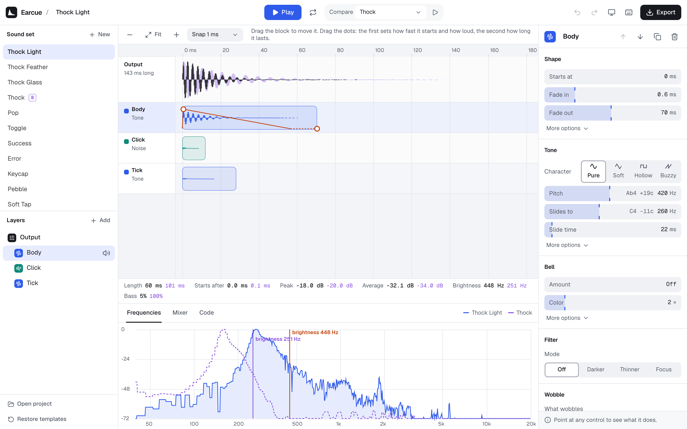

<p align="center">
  <a href="https://earcue.vercel.app">
    <picture>
      <source media="(prefers-color-scheme: dark)" srcset="docs/brand/earcue-mark-dark.svg">
      
    </picture>
  </a>
</p>

<h1 align="center">Earcue</h1>

<p align="center">Design the sounds your interface makes.</p>

<p align="center">
  <a href="https://earcue.vercel.app"><strong>Open Earcue</strong></a>
  ·
  <a href="#use-your-sounds-in-code">Use sounds in code</a>
  ·
  <a href="https://github.com/x0rk/earcue/issues/new/choose">Report a bug</a>
</p>

<picture>
  <source media="(prefers-color-scheme: dark)" srcset="docs/screenshot-dark.png">
  
</picture>

Earcue is a free, open-source editor for the small sounds in a product: taps, toggles, message sends, successes, errors and notifications. You build each sound from layers, shape it on a timeline, compare it with other sounds, and ship the whole set to your app as a few kilobytes of JavaScript.

It's made for designers and engineers who have never touched audio software. Every control says what it does in plain words, and pointing at one explains it.

## Why

Most UI sounds today come from frozen sound packs or from code someone tuned by hand. Earcue treats them like the rest of a design system: one set of sounds that share a key, a material and a level, designed together and shipped together.

## Features

**Design**

- Start from a template (Thock, Pop, Toggle, Success, Error, Keycap and more) or from a blank sound.
- Stack layers: a tone you can slide and shape, noise for clicks and air, a struck object of metal, glass, wood or skin, and your own recordings or audio files.
- Drag a layer's block to move it on the timeline. Drag its dots to set how fast it starts, how loud it is and how long it lasts.
- Shape it further with filters and sweeps, wobble (vibrato and tremolo), grit, room, echo, tone controls and a loudness target.

**Judge**

- Compare against another sound or any audio file, with overlaid waveforms and frequency charts.
- Read the measurements side by side: length, start delay, peak, average loudness, brightness and bass.
- Balance layers in the mixer. Undo anything. Use keyboard shortcuts for the common actions.

**Ship**

- Export one sound or the whole set.
- Get WAV files, a JavaScript module that plays the sounds with no audio files, or an editable project.

## Use your sounds in code

Export the set as **Code**, put `sounds.js` in your project, and play sounds by name:

```js
import { playSound } from './sounds.js';

let audio;

sendButton.addEventListener('click', () => {
  // Browsers only allow sound after a click or key press, so create the AudioContext in one.
  audio ??= new AudioContext();
  playSound('thock-light', audio);
});
```

Sounds are stored as recipes and rendered with the Web Audio API, so a set of six sounds is about 32 KB of JavaScript, or about 6 KB once your server compresses it. Audio clips add to that, but only the part of each clip that plays is included.

The playback code in every export comes from Earcue and carries a one-line MIT License notice. Keep it when you ship the file.

## Export formats

| Format | What you get |
|---|---|
| Audio file | A WAV: mono or stereo, 44.1 or 48 kHz, 16 or 24-bit, normalized to your loudness target |
| Code | A JavaScript module with `playSound`. No audio files needed |
| Everything | A zip with the WAV, the code, the editable project and a README |
| Project | A `.json` file you can open in Earcue again or share |
| Whole set | One WAV per sound, plus a single `sounds.js` |

Earcue imports WAV, MP3, OGG, M4A, FLAC and WebM files, and AIFF in Safari, as far as your browser can decode them. It exports WAV. If you need smaller files, convert with a tool such as ffmpeg.

## Your data

Everything runs in your browser. Sounds and recordings are saved in your browser's storage and are never uploaded. Audio you remove is deleted from that storage the next time you open Earcue. Export a project file to move work to another browser or share it. Project files keep recordings whole, trimmed parts included.

## Run it locally

You need Node.js 20.19 or later.

```bash
npm install
npm run dev
```

Microphone recording needs `localhost` or HTTPS.

## Contributing

Issues and pull requests are welcome. [CLAUDE.md](CLAUDE.md) explains how the code is organized, the writing rules for the interface, and the git workflow.

## License

[MIT](LICENSE)
