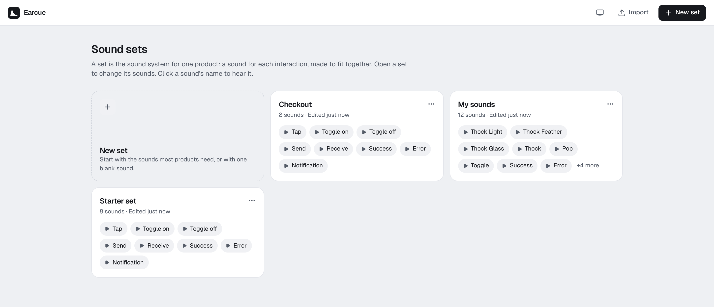
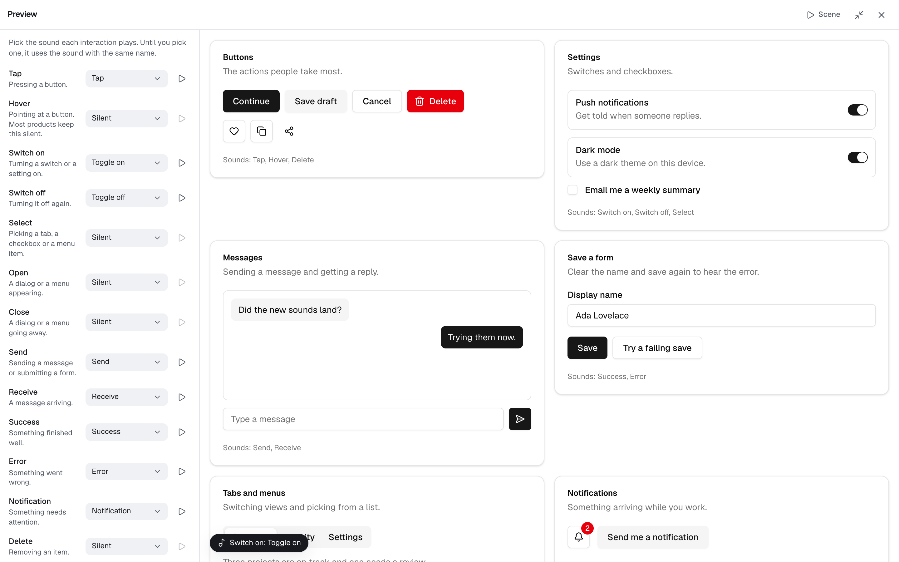

<p align="center">
  <a href="https://earcue.vercel.app">
    <picture>
      <source media="(prefers-color-scheme: dark)" srcset="docs/brand/earcue-mark-dark.svg">
      
    </picture>
  </a>
</p>

<h1 align="center">Earcue</h1>

<p align="center">Design the sounds your interface makes.</p>

<p align="center">
  <a href="https://earcue.vercel.app"><strong>Open Earcue</strong></a>
  ·
  <a href="#use-your-sounds-in-code">Use sounds in code</a>
  ·
  <a href="https://github.com/x0rk/earcue/issues/new/choose">Report a bug</a>
</p>

<picture>
  <source media="(prefers-color-scheme: dark)" srcset="docs/screenshot-dark.png">
  
</picture>

Earcue is a free, open-source editor for the small sounds in a product: taps, toggles, message sends, successes, errors and notifications. You keep each product's sounds together as a set, build each sound from layers, shape it on a timeline, compare it with other sounds, and ship the whole set to your app as a few kilobytes of JavaScript.

It's made for designers and engineers who have never touched audio software. Every control says what it does in plain words, and pointing at one explains it.

## Why

Most UI sounds today come from frozen sound packs or from code someone tuned by hand. Earcue treats them like the rest of a design system: one set of sounds that share a key, a material and a level, designed together and shipped together.

## Features

**Design**

- Keep a set of sounds for each product on the home page. A new set can start with a sound for each of the 28 interactions most product sound kits cover (tap, typing, switches, open and close, back, swipe, send and receive, success, complete, celebrate, cancel, delete, warning, error, notification, urgent alert, ring, alarm, lock and unlock, connect and disconnect, capture), made in one key, one material and one room so they sound like a family. Or start with just the basic eight.
- Explore openly licensed kits on the home page: Material, Android, KDE Ocean, Kenney and eleven uisfx packs. Play them there, or open one as a set to change and export. Each kit's sounds come mapped to the interactions they were made for.
- Add sounds from templates (Thock, Pop, Keycap, Pebble and more) or start from a blank sound.
- Stack layers: a tone you can slide and shape, noise for clicks and air, a struck object of metal, glass, wood or skin, and your own recordings or audio files.
- Drag a layer's block to move it on the timeline. Drag its dots to set how fast it starts, how loud it is and how long it lasts. Recordings get the same dots, plus trimming and a pitch slide.
- Clean up a recording: remove background noise (learned from the quiet part before the sound starts), mains hum at 50 or 60 Hz, and room noise between sounds with a gate. The original clip is kept, so every step can be turned back down.
- Make the opposite of any sound in one step: its notes play in reverse and its slides run the other way, the way Toggle off mirrors Toggle on.
- Make a variant: another take on a sound with new noise and a few cents of change, the way kits ship four taps instead of one. An interaction with several sounds plays one at random, never the same one twice in a row, so a sound heard all day never repeats exactly.
- Grow a whole set from one sound, the way a studio builds a product's sounds from one motif or one recording. Earcue plays it once for Tap, twice rising for Toggle on, sliding up for Send, as a chord for Success and so on, keyed to the sound's own note. A recording with a clear pitch works too.
- Give a set a palette: the key its notes stay in, how loud frequent sounds, confirmations and alerts are, and the room they share. Change the key and every note moves to the same step of the new scale, so tunes keep their shape. Each change applies to every sound at once, as one undo step.
- Shape it further with filters and sweeps, wobble (vibrato and tremolo), grit, echo, tone controls and a loudness target.
- Stack effects on any layer: EQ, a compressor, chorus, a flanger, a phaser and a bitcrusher, in the order you choose.
- Put the whole sound in a room, hall, plate or spring reverb, or reverse it so it swells up, and round off peaks with a limiter. None of it adds delay, so sounds still land on time.



**Judge**

- Try the set on real UI. The preview opens beside the editor or full screen, with buttons, switches, a chat, a form, tabs, a menu, a dialog, a task list, onboarding, an upload, device controls and an incoming call, built in the style of [shadcn/ui](https://ui.shadcn.com). Pick the sounds each interaction plays, and play a short scene of tap, send, receive and success to hear the set together. A ring or an alarm repeats until you answer or stop it.
- Checks flag what breaks a family: sounds that start late, bass that small speakers can't play, sounds too long for their interaction, frequent sounds as loud as alerts, notes outside the set's key, and notes that rub where one sound runs into the next. Notes from the wider scale around a pentatonic key count as fitting, a quick slide counts where it lands, and a sound can be marked as clashing on purpose, the way an error often does.
- Compare against another sound or any audio file, with overlaid waveforms and frequency charts.
- Read the measurements side by side: length, start delay, peak, average loudness, brightness and bass.
- Balance layers in the mixer. Undo anything. Use keyboard shortcuts for the common actions, or right-click a sound, a layer, a set or a kit for everything you can do with it.



**Ship**

- Export one sound or the whole set, and import a set back from its zip.
- Get WAV or OGG files, a JavaScript module that plays the sounds with no audio files, or an editable project. The set's module also plays by interaction (`playRole('tap', ctx)` picks one of its variants) and loops a ring with `loopRole('ring', ctx)`.
- A set made from a kit keeps the kit's credit, and zip exports carry it in their README.

## Use your sounds in code

Export the set as **Code**, put `sounds.js` in your project, and play sounds by name:

```js
import { playSound } from './sounds.js';

let audio;

sendButton.addEventListener('click', () => {
  // Browsers only allow sound after a click or key press, so create the AudioContext in one.
  audio ??= new AudioContext();
  playSound('send', audio);
});
```

Sounds are stored as recipes and rendered with the Web Audio API, so a set of six sounds is about 32 KB of JavaScript, or about 6 KB once your server compresses it. Audio clips add to that, but only the part of each clip that plays is included.

The playback code in every export comes from Earcue and carries a one-line MIT License notice. Keep it when you ship the file.

## Export formats

| Format | What you get |
|---|---|
| Audio file | A WAV (mono or stereo, 44.1 or 48 kHz, 16 or 24-bit) or an OGG (Ogg Vorbis, several times smaller), normalized to your loudness target |
| Code | A JavaScript module with `playSound`. No audio files needed |
| Everything | A zip with the audio file, the code, the editable project and a README |
| Project | A `.json` file you can open in Earcue again or share |
| Whole set | One audio file per sound, plus a single `sounds.js` |

OGG files play in current browsers, on Android and in game engines such as Godot and Unity. Safari plays them from version 18.4. Earcue encodes them in your browser with libvorbis, compiled to WebAssembly, which loads only when you export an OGG.

Earcue imports WAV, MP3, OGG, M4A, FLAC and WebM files, and AIFF in Safari, as far as your browser can decode them. For MP3, export a WAV and convert it with a tool such as ffmpeg.

## Your data

Everything runs in your browser. Sets, sounds and recordings are saved in your browser's storage and are never uploaded. Audio that no set uses any more is deleted from that storage the next time you open Earcue. Export a project file to move work to another browser or share it. Project files keep recordings whole, trimmed parts included.

## Run it locally

You need Node.js 22.12 or later.

```bash
npm install
npm run dev
```

`npm test` runs the test suite.

Microphone recording needs `localhost` or HTTPS.

## Contributing

Issues and pull requests are welcome. [CLAUDE.md](CLAUDE.md) explains how the code is organized, the writing rules for the interface, and the git workflow.

## License

[MIT](LICENSE), except the bundled kits in `public/kits`, which keep their own licences. Each kit's folder holds its licence or notice:

| Kit | By | Licence |
|---|---|---|
| [Kenney UI Audio](https://kenney.nl/assets/ui-audio) and [Interface Sounds](https://kenney.nl/assets/interface-sounds) | Kenney | CC0 1.0 |
| [Material product sounds](https://web.archive.org/web/20190717142129/https://material.io/design/sound/sound-resources.html) | Google | CC BY 4.0 |
| [Android UI sound effects](https://android.googlesource.com/platform/frameworks/base/+/refs/heads/main/data/sounds/effects/ogg/) | The Android Open Source Project | Apache 2.0 |
| [Ocean Sound Theme](https://invent.kde.org/plasma/ocean-sound-theme) | Guilherme Marçal Silva for KDE | CC BY-SA 4.0 |
| [uisfx](https://github.com/romainsimon/uisfx) 0.4.0, eleven of its packs | uisfx | CC0 1.0 |

Sounds you make from the Material, Android or KDE Ocean recordings need their credit when you share them, and sounds made from KDE Ocean stay CC BY-SA 4.0.
